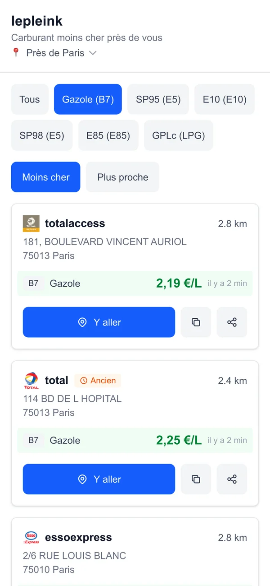
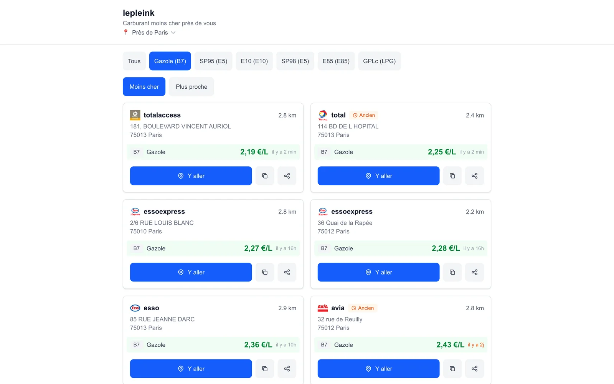

# Le Plein

Find the cheapest fuel near you in France. Allow location access or type a town, pick a fuel and
get nearby stations sorted by price. The interface is in French and built for phones.

**Live at [leple.ink](https://leple.ink)**

| Mobile | Desktop |
| --- | --- |
|  |  |

## Features

- **Your location or any town**: uses the browser's geolocation, or a town or address you type in.
- **Fuel filter**: Gazole (B7), SP95 (E5), E10, SP98 (E5), E85 and GPLc (LPG). Picking one hides
  stations that don't sell it or are out of it. "Tous" shows up to three fuels per station.
- **Sorting**: cheapest first or nearest first. Out-of-stock fuel goes to the bottom of the
  price sort. The fuel and sort order are remembered between visits.
- **Freshness**: each price shows when it was last updated, and stations with a price older
  than 48 hours get an "Ancien" badge. Out-of-stock fuel is marked "Rupture".
- **Actions**: "Y aller" opens directions (Apple Maps on iOS, Google Maps elsewhere), and the
  other buttons copy the address or share the station.
- **Bad connections**: requests time out after 10 seconds and retry with backoff, cached
  results stay on screen with a warning, and a banner shows when you're offline.

## Development

Requires Node 20.9+ and pnpm.

```bash
pnpm install
pnpm dev            # http://localhost:3000
pnpm test           # Vitest in watch mode (pnpm test --run runs once)
pnpm lint
pnpm build
```

No API keys or environment variables are needed.

## How it's built

Next.js 16 (App Router), React 19, TypeScript, Tailwind CSS 4, SWR and Vitest, deployed on
Vercel. Everything runs in the browser. Prices come from the
[prix-carburants API](https://api.prix-carburants.2aaz.fr), a free third-party API over the
government's [prix-carburants open data](https://www.prix-carburants.gouv.fr/rubrique/opendata/)
(its spec is in `swagger.yaml`). Its `/stations/around` endpoint returns nearby stations
without prices, so the app then fetches `/station/{id}` for each one, five at a time. Town
search uses the [IGN Géoplateforme geocoder](https://data.geopf.fr/geocodage), and the place name
under the title comes from BigDataCloud's reverse geocoding.

| Path | What |
| --- | --- |
| `src/hooks/useStations.ts` | Fetches nearby stations, then each station's prices |
| `src/components/stations/StationList.tsx` | Filtering, sorting and the result list |
| `src/components/stations/StationCard.tsx` | A station with its prices and the directions, copy and share buttons |
| `src/contexts/GeolocationContext.tsx` | Browser location or a manually chosen place |
| `src/lib/fetcher.ts`, `src/lib/retryStrategy.ts` | Timeouts, error types and retry with backoff |
| `src/lib/constants.ts` | Fuel types and the 48-hour staleness threshold |
